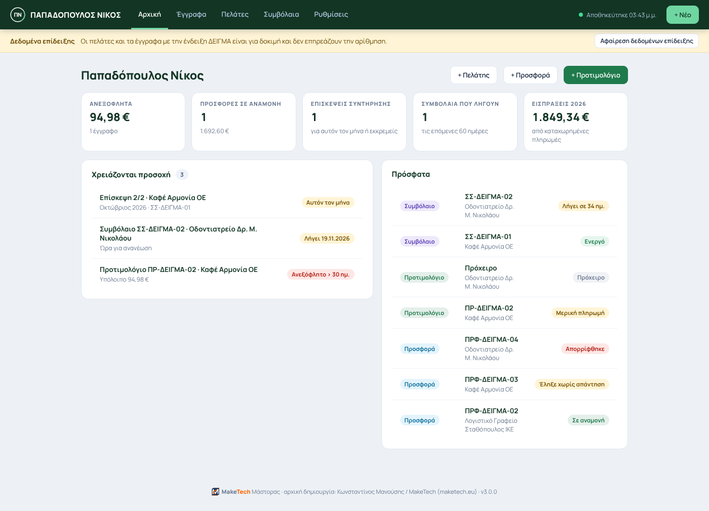
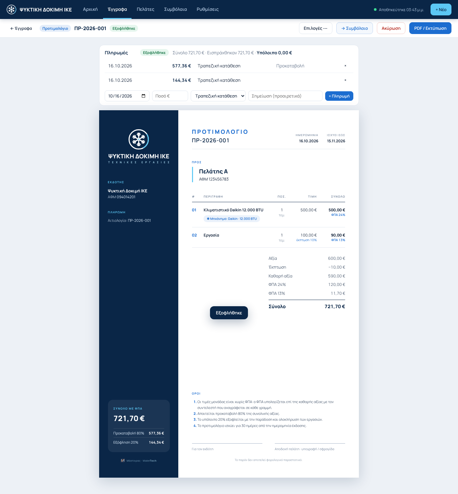
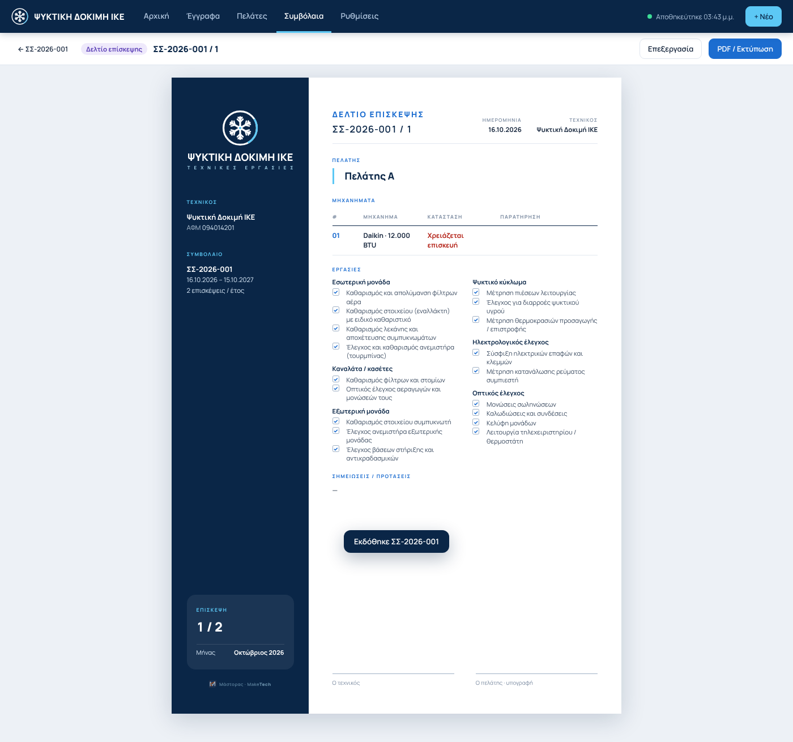

<p align="center"></p>

# Μάστορας · Έγγραφα & Πελάτες

**Προσφορές, προτιμολόγια, συμβόλαια συντήρησης και πελατολόγιο, σε ένα αρχείο.**
Για τεχνικούς, συνεργεία και μικρές επιχειρήσεις. Δωρεάν και ανοιχτού κώδικα.

- **Χωρίς εγκατάσταση και χωρίς server.** Ένα αρχείο HTML που ανοίγει σε Chrome ή Edge.
- **Τα δεδομένα μένουν σε φάκελο του υπολογιστή σας** (ιδανικά μέσα στο Google Drive / OneDrive για αυτόματο αντίγραφο). Τίποτα δεν στέλνεται πουθενά.
- **Με το δικό σας λογότυπο και χρώματα** στα έγγραφα.

## Τι κάνει
| | |
|---|---|
| **Προσφορές & προτιμολόγια** | αυτόματη αρίθμηση με την έκδοση, έκπτωση και ΦΠΑ ανά γραμμή, κατάλογος εργασιών, PDF A4 |
| **Ροή προσφοράς** | σε αναμονή → αποδεκτή → προτιμολόγιο → πληρωμές → συμβόλαιο |
| **Πληρωμές** | προκαταβολή, εξόφληση, υπόλοιπο ανά έγγραφο και ανά πελάτη |
| **Πελατολόγιο** | έλεγχος ΑΦΜ, εξοπλισμός / μηχανήματα με εγγυήσεις |
| **Συμβόλαια συντήρησης** | πρόγραμμα επισκέψεων, καταγραφή, δελτίο επίσκεψης (και κενό για το πεδίο) |
| **Αρχική σελίδα** | ανεξόφλητα, προσφορές σε αναμονή, επισκέψεις του μήνα, συμβόλαια που λήγουν |
| **Ασφάλεια δεδομένων** | ημερήσια αντίγραφα, επαναφορά, ακύρωση αντί για διαγραφή, εξαγωγή CSV για Excel |

Υπάρχουν δύο προφίλ: **ψύξη & κλιματισμός** (μηχανήματα με μάρκα/BTU) και **γενική επιχείρηση**.

<p align="center"> </p>

## Ξεκινήστε
1. Κατεβάστε το **`mastoras.html`** από τα [Releases](../../releases) (ή από τον φάκελο `dist/`).
2. Βάλτε το σε έναν φάκελο, π.χ. μέσα στο Google Drive του υπολογιστή, και ανοίξτε το με **Chrome** ή **Edge**.
3. «Επιλογή φακέλου» → τον ίδιο φάκελο → «Επεξεργασία αρχείων». Ο οδηγός κάνει τα υπόλοιπα.
   Στο τέλος μπορείτε να φορτώσετε **δεδομένα επίδειξης**, που αφαιρούνται με ένα κουμπί.

Θέλετε απλώς να το δείτε; Ανοίξτε το με `?opfs=1` στο τέλος της διεύθυνσης: λειτουργεί σε ιδιωτικό χώρο του browser, χωρίς φάκελο.

Αναλυτικές οδηγίες: [docs/ΟΔΗΓΙΕΣ.md](docs/ΟΔΗΓΙΕΣ.md)

> **Σημαντικό:** ο Μάστορας **δεν εκδίδει φορολογικά παραστατικά** και δεν συνδέεται με το myDATA. Τα προτιμολόγια και οι προσφορές είναι μη φορολογικά έγγραφα. Παρέχεται «ως έχει», χωρίς καμία εγγύηση (βλ. LICENSE).

**Υποστηριζόμενοι browsers:** Chrome, Edge, Brave, Opera σε υπολογιστή (File System Access API). Όχι Firefox/Safari, όχι κινητά.

## Για προγραμματιστές
```
src/js/      κώδικας (core → brand/shell → documents → contracts/settings)
src/css/     base.css (κέλυφος, A4 έγγραφο) + app.css
src/fonts/   Manrope (SIL OFL 1.1)
build.py     χτίζει το dist/mastoras.html (μόνο Python 3)
tests/       Playwright τεστ από άκρη σε άκρη
```
```bash
python3 build.py
pip install pytest playwright pillow && playwright install chromium
pytest -q tests                 # SHOTS=1 για στιγμιότυπα στο docs/screenshots
```
Δεν υπάρχουν εξαρτήσεις στην εφαρμογή: vanilla JavaScript, ένα αρχείο. Οι αλλαγές γίνονται στο `src/` και το `dist/` ξαναχτίζεται.
Συνεισφορές καλοδεχούμενες — δείτε [CONTRIBUTING.md](CONTRIBUTING.md).

## Άδεια
**GNU GPL-3.0** με πρόσθετους όρους (§7) — [LICENSE](LICENSE), [ADDITIONAL-TERMS.md](ADDITIONAL-TERMS.md).

Με απλά λόγια: χρησιμοποιήστε τον ελεύθερα, και επαγγελματικά. Αλλάξτε τον και μοιραστείτε τον. Αν διανείμετε δική σας έκδοση:
- δίνετε κι εσείς τον κώδικα ανοιχτό με την ίδια άδεια·
- κρατάτε ορατή στην εφαρμογή την αναφορά «*Μάστορας · αρχική δημιουργία: Κωνσταντίνος Μανούσης / MakeTech (maketech.eu)*»·
- δεν χρησιμοποιείτε τα ονόματα/λογότυπα MakeTech και K.M. ως δικά σας (τα λογότυπα μπορείτε να τα αφαιρέσετε).

Η υπογραφή στα PDF των χρηστών είναι προαιρετική και κλείνει από τις Ρυθμίσεις.

---

**English:** *Mastoras* is a free, single-file web app (Greek UI) for small trade businesses: quotes, pro-forma invoices, maintenance contracts with visit sheets, payments and a client book. Data stays in a local folder via the File System Access API (Chrome/Edge desktop). Licensed under GPL-3.0 with a §7(b) attribution term and a §7(e) trademark term.

© 2026 Κωνσταντίνος Μανούσης · [MakeTech](https://maketech.eu)
